# STEEL CHAIN（スティール・チェイン）

ゲームボーイアドバンス（GBA）向けの横スクロール・アクションゲームです。
実機（フラッシュカート）や mGBA などの GBA エミュレータで遊べます。

> 機械に支配された工業都市。小型戦闘ロボ **STEEL** はエネルギーブレードを手に、
> 中枢コアを目指して工場区画を駆け抜ける——。

<p align="center">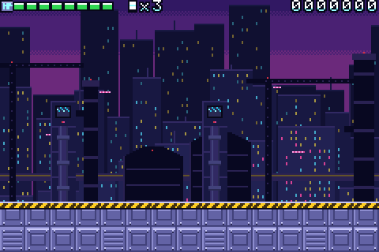</p>

| | |
| --- | --- |
| 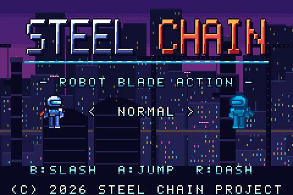 | 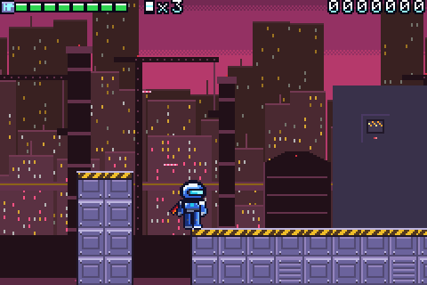 |
| 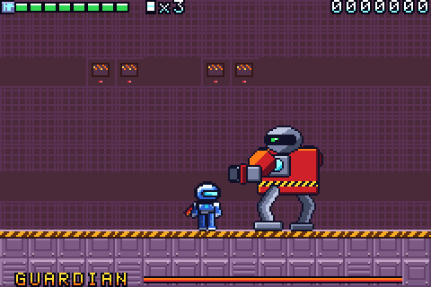 | 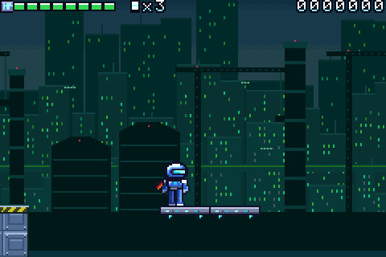 |
| 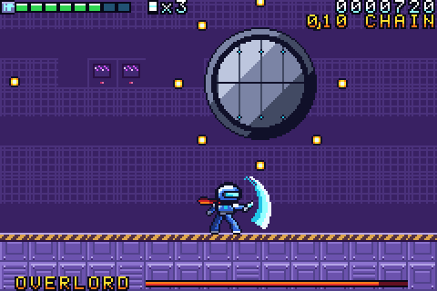 | 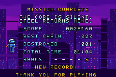 |
| 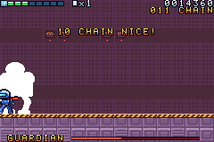 | 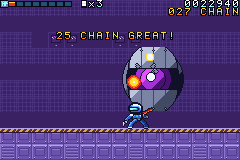 |
| 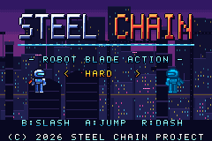 | 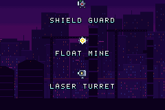 |
| 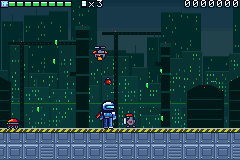 | 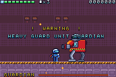 |
| 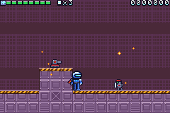 | 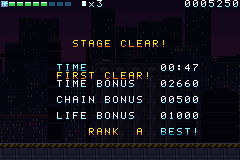 |
| 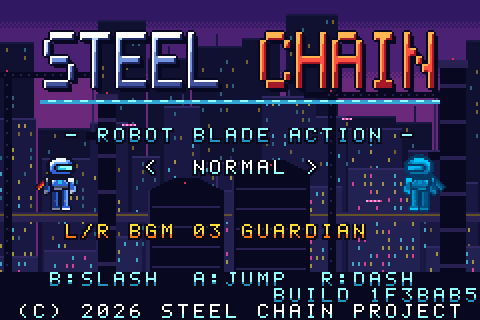 |  |

（画像はすべて CI と同じヘッドレスランナーで実機ROMを動かして撮影したもの。`build/runner steel_chain.gba <出力先> demo1_0` で連番フレームを書き出せます）

## 遊び方

最新の ROM は [Releases](../../releases) から `steel_chain-build-*.gba` をダウンロードし、
[mGBA](https://mgba.io/) などで開いてください。

GitHub Pages が有効なら、`https://<ユーザー名>.github.io/gba-action/` でブラウザからも遊べます（EmulatorJS 使用）。
ハイスコアは SRAM に保存されます（エミュレータでは .sav ファイル）。

| ボタン | 操作 |
| --- | --- |
| 十字キー | 移動 |
| A | ジャンプ（長押しで高く） / 下+A で足場をすり抜け |
| B | 斬る（連打で 3 段コンボ、空中では回転斬り） |
| B 長押し→離す | チャージ斬り（飛ぶ斬撃波。盾を貫通し、敵弾も消す） |
| R / L | ダッシュ（無敵時間あり、空中でも 1 回） |
| ダッシュ中に B | ダッシュ斬り（突進して 2 ダメージ、盾のガードを崩す。そのまま B で斬り上げへ） |
| START | 開始 / ポーズ |
| 十字キー左右（タイトル） | 難易度 EASY / NORMAL / HARD の切り替え |
| 十字キー上下（タイトル） | 開始ステージの選択（一度到達したステージから） |
| L / R（タイトル） | サウンドテスト（クリア後のおまけ。全 11 曲を試聴） |

### ゲームの特徴

- **CHAIN（連鎖）システム**: 攻撃を当て続けると CHAIN が伸び、スコア倍率が上がる。ステージクリア時に最大 CHAIN がボーナスになる
- **3 段コンボ**: 横薙ぎ → 斬り上げ → 叩きつけ。3 段目は盾持ちの敵のガードも砕く
- **攻撃キャンセル**: 攻撃後の硬直はジャンプ・ダッシュでキャンセル可能
- **弾消し**: 斬撃で敵弾をかき消せる（CHAIN も伸びる）
- **全5ステージ**: 工場 → スカイウェイ → 鋳造所(ボス) → データハイウェイ → 中枢コア(最終ボス)
- **ボス戦**: 工場の守護ロボ GUARDIAN。突進を壁に誘導すると気絶して大チャンス
- **最終ボス**: OVERLORD CORE。装甲が開いて目が露出したときだけ攻撃が通る
- **ランク評価とベストタイム**: ステージクリア時にタイム・最大 CHAIN・ミス回数・残り HP で S/A/B/C を判定。ステージ別の最高ランクとベストタイムを保存し、タイトルのステージ選択に表示
- **爆撃ドローン**: 頭上から爆弾を落とす敵。爆弾は斬って消せる
- **環境演出**: 鋳造所の火の粉、データハイウェイのデータ片、中枢コアの光の粒
- **スコアエクステンド**: 20000 点で残機 +1、以降 40000 点ごとに +1（1UP! と表示）
- **ステージ紹介に自己ベスト**: 一度クリアしたステージは、開始前の紹介画面にベストタイムと最高ランクを表示
- **ノーダメージボーナス**: 被弾もミスもせずにステージをクリアすると +5000 点
- **中間地点**: 柱の列を通過すると点灯 (飛び越しても OK)。画面上部に CHECKPOINT と表示
- **コンティニュー**: ゲームオーバー後 10 秒のカウントダウン中に START で続きから
- **ポーズ画面**: 操作のおさらいを表示。BGM のオン/オフも切り替えられる（効果音は鳴ったまま）。BGM の設定と最後に選んだ難易度はセーブされる
- **CHAIN の節目演出**: 10 / 25 / 50 / 100 CHAIN でポップアップとボーナス
- **ボス撃破演出**: とどめの一撃でヒットストップ → スローモーションで爆発
- **難易度 3 段階**: EASY（HP12・残機5）/ NORMAL（HP8）/ HARD（HP6・敵弾が速い・回復が出にくい）
- **デモプレイ**: タイトルで約 20 秒放置すると自動プレイのデモが流れる
- **エンディング**: リザルト → 専用曲のスタッフロール（キャスト紹介）→ THE END
- **ステージ別 BGM**: 全 5 ステージにそれぞれ専用曲（工場 / スカイウェイ / 鋳造所 / データハイウェイ / 中枢コア）。ボス戦・クリア・ゲームオーバー・エンディングにも専用曲

## ビルド方法

Ubuntu / Debian の標準パッケージだけでビルドできます（devkitPro 不要）。

```sh
sudo apt-get install gcc-arm-none-eabi python3
make            # steel_chain.gba が生成される
```

### テスト（ヘッドレス自動プレイ）

mGBA のコアライブラリを使い、ROM を画面なしで実行して自動操作・状態検証・スクリーンショット保存・BGM の録音（WAV）を行います。

```sh
sudo apt-get install libmgba-dev zlib1g-dev
make test                                        # スモークテスト (build/test-out/*.png)
build/runner steel_chain.gba build/bot-out bot   # ボットによる通しプレイ
build/runner steel_chain.gba build/boss-out boss # ボス戦へ直行してボット戦術で撃破を検証 (boss5 で最終ボス)
build/runner steel_chain.gba build/st4 stage4    # 指定ステージからボットでプレイ (TRACE=<x> で x 付近の挙動をログ出力)
build/runner steel_chain.gba build/m music       # 全 BGM・効果音を WAV に録音
build/runner steel_chain.gba build/a attract     # タイトル放置→デモプレイ
build/runner steel_chain.gba build/s soundtest   # クリア後のサウンドテスト (L/R で曲送り)
build/runner steel_chain.gba build/e extend      # スコアエクステンド (20000 / 60000 点で 1UP)
build/runner steel_chain.gba build/p pausebgm    # ポーズメニューの BGM オン/オフ
build/runner steel_chain.gba build/c settings    # 設定 (BGM・難易度) がリセット後も残るか
build/runner steel_chain.gba build/e boteasy     # EASY でボット通しプレイ (bothard で HARD)
build/runner steel_chain.gba build/g gameover    # ゲームオーバー → コンティニュー / 放置でタイトル
build/runner steel_chain.gba build/n nodamage    # ノーダメージボーナス
HURT_LOG=1 build/runner steel_chain.gba build/st2 stage2  # ボットの被弾位置をログ出力 (難所探し)
```

ROM は EWRAM 先頭 (`0x02000000`) にデバッグ情報ブロック（状態・座標・HP・スコア等）を置いており、
テストランナーはこれを読んで判定します。

## ディレクトリ構成

```
src/            ゲーム本体 (C)
  crt0.s        起動コード・ROM ヘッダ・割り込み
  main.c        メインループ・画面遷移・HUD・CHAIN 演出
  title.c       タイトル画面・難易度/ステージ選択・デモプレイ
  ending.c      エンディング・スタッフロール
  player.c      主人公 (移動/ジャンプ/ダッシュ/コンボ)
  enemy.c       敵・チェックポイント・ゴール・弾・動く足場
  boss.c        ボス GUARDIAN
  core.c        最終ボス OVERLORD CORE
  level.c       ステージ・当たり判定・スクロール・カメラ
  fx.c          エフェクト
  sound.c       効果音・BGM シーケンサ (PSG)
  save.c        SRAM セーブ (ハイスコア・到達ステージ)
include/gba.h   GBA ハードウェア定義
assets/         スプライト (ASCII アート) / ステージ定義 (テキスト)
tools/          アセット生成 (Python)
tests/runner.c  ヘッドレステストランナー (libmgba)
```

### アセットの編集

- `assets/sprites.txt` … 敵・アイテムのドット絵（1 文字 = 1 ピクセル、文字とパレットの対応はファイル先頭）
- `tools/compose_player.py` … 主人公のポーズ（関節座標）を編集して `make sprites` で再合成
- `assets/music/*.txt` … BGM の楽譜（`C-5` 音符、`---` 伸ばす、`...` 消音、ドラムは `K`=キック `S`=スネア `H`=ハット）
- `tools/build_levels.py` … ステージ 2 以降を区画の組み合わせで生成（`python3 tools/build_levels.py`）
- `assets/levels/*.txt` … ステージ（`#`=壁 `=`=足場 `^`=トゲ `P`=開始位置 `c/d/t/j/s`=敵 `C`=中間地点 `G`=ゴール `+`=回復 `L/l`=横に動く足場 `V/v`=縦に動く足場（小文字は逆位相） `>`/`<`=ベルトコンベア `m`=浮遊機雷 `x`/`X`=レーザー砲台（左/右向き） `u`=爆撃ドローン `B`/`Z`=ボス）

## CI / CD

- Pull Request ごとに GitHub Actions で ROM をビルドし、ヘッドレステストを実行（スクリーンショットは Artifacts に保存）
- `main` へのマージで ROM を自動ビルドし、GitHub Releases に公開
- 同時にブラウザ版（`web/index.html` + ROM）を GitHub Pages に公開（リポジトリ設定で Pages のソースを「GitHub Actions」にする必要あり）

開発の進め方と今後の計画は [ROADMAP.md](ROADMAP.md) を参照してください。

## 注意

ROM ヘッダの任天堂ロゴ領域は空になっています。エミュレータではそのまま動作しますが、
実機で起動する場合は devkitPro の `gbafix` 等でロゴを書き込んでください。
